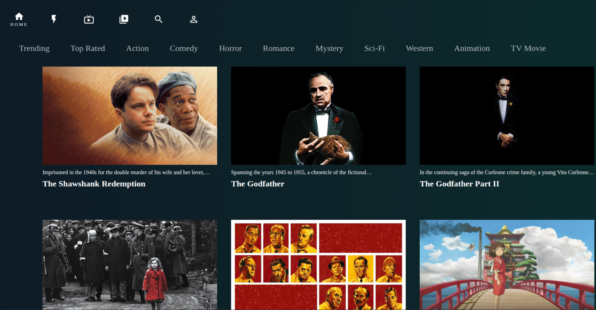

# 🎬 Hulu Clone (React + Docker)



A Hulu-style movie browsing application built with **React (Create React App)** and powered by **real-time TMDB API data**.  
The application is containerised using a **multi-stage Docker build** and served via **nginx** for fast, production-grade delivery.

---

## 🚀 Features

- Responsive Hulu-style user interface
- Real movie data fetched from the TMDB API
- Category-based browsing (Trending, Top Rated, Action, etc.)
- Optimized production build served via nginx
- Fully containerised frontend (no Node.js runtime in production)

---

## 🛠 Tech Stack

- **Frontend:** React (Create React App)
- **UI:** Material UI (icons)
- **Data Source:** TMDB REST API
- **Package Manager:** npm
- **Containerization:** Docker (multi-stage build)
- **Web Server:** nginx
- **Registry:** Azure Container Registry (ACR)
- **Runtime:** Azure Container Apps

---

## 📁 Project Structure

```plaintext
HULU-CLONE/
├── src/                # React source code
├── public/             # Static public assets
├── nginx.conf          # nginx SPA routing configuration
├── Dockerfile          # Production Dockerfile
├── .dockerignore       # Docker build exclusions
├── package.json        # Node.js dependencies
├── package-lock.json   # Dependency lock file
└── README.md           # Project documentation
```

---

## 🧑‍💻 Local Development (Node.js)

### Prerequisites

- Node.js 18 or later
- npm

### Install Dependencies

```bash
npm install
```

### Run the Application

```bash
npm start
```

### Open in Your Browser

[http://localhost:3000](http://localhost:3000)

---

## 🐳 Docker (Production)

Running the app via Docker is the recommended approach.

### Build the Docker Image

```bash
docker build -t hulu-clone:prod .
```

### Run the Container

```bash
docker run --rm -p 3000:80 hulu-clone:prod
```

### Open in Your Browser

[http://localhost:3000](http://localhost:3000)

### What Happens in Docker

- React app is built using Node.js in a build stage.
- A static production build is generated.
- nginx serves the static files.
- No Node.js runtime is required in the final image.

---

## 🔁 CI/CD with GitHub Actions

This project uses **GitHub Actions** to automatically build and publish the Docker image.

### What Happens on Push

- ✅ React app is built and validated.
- 🐳 Docker image is created using a multi-stage build.
- 📤 Image is pushed to **GitHub Container Registry (GHCR)**.

### Image Naming

```plaintext
ghcr.io/<github-username>/hulu-clone:latest
```

### Pull and Run the Published Image

```bash
docker pull ghcr.io/<github-username>/hulu-clone:latest
docker run --rm -p 3000:80 ghcr.io/<github-username>/hulu-clone:latest
```

---

## ☁️ Cloud Deployment (Azure)

This application is deployed as a containerised frontend using Azure’s managed container services.

### Runtime Architecture

- **Azure Container Registry (ACR):** Stores the production Docker image.
- **Azure Container Apps:** Runs the container in a managed environment without direct Kubernetes management.
- **nginx:** Serves the static SPA over a public HTTPS endpoint.

### Deployment Flow

1. React app is built using a multi-stage Dockerfile.
2. Production image is pushed to Azure Container Registry.
3. Azure Container Apps securely pulls the image from ACR.
4. The app is exposed via a public endpoint.

This mirrors real-world cloud deployment patterns for containerised SPAs.

> **Note:** Registry authentication is required even when ACR is publicly reachable. Runtime identity is handled separately from local Docker authentication.

---

## ☸️ Kubernetes Deployment (Local k3s)

This application has been deployed to a local Kubernetes cluster (k3s) to simulate a production-style environment.

### Architecture

```
Browser → hulu.local → Ingress (Traefik) → Service → Pod (nginx)
```

### Components

- **Deployment:** Runs the containerised application
- **Service (ClusterIP):** Internal routing within the cluster
- **Ingress (Traefik):** Handles domain-based routing via `hulu.local`

### Access

The application is exposed locally using a custom domain:

[http://hulu.local](http://hulu.local)

This is achieved via a local `/etc/hosts` mapping.

### Key Learnings

- Containerised application deployment on Kubernetes
- Service-based networking and routing
- Ingress controller configuration (Traefik)
- Local DNS simulation using `/etc/hosts`

---

## 🌐 SPA Routing

This application is a Single Page Application (SPA). The nginx configuration ensures that client-side routes work correctly on refresh or direct access:

```nginx
location / {
  try_files $uri $uri/ /index.html;
}
```

Without this configuration, refreshing routes such as `/movie/123` would result in a 404 error.

---

## 🔐 TMDB API Notes

- Movie data is fetched client-side from the TMDB API.
- API keys used in the frontend are public-read and visible in the browser.
- This is expected behavior for TMDB and similar public APIs.
- No secrets are stored inside the Docker image.

---

## 📦 Why nginx + Docker?

- Faster and lighter than running a Node.js dev server.
- Smaller, more secure runtime image.
- Matches real-world SPA deployment patterns (CDN / edge hosting).
- Clear separation between build-time and runtime concerns.